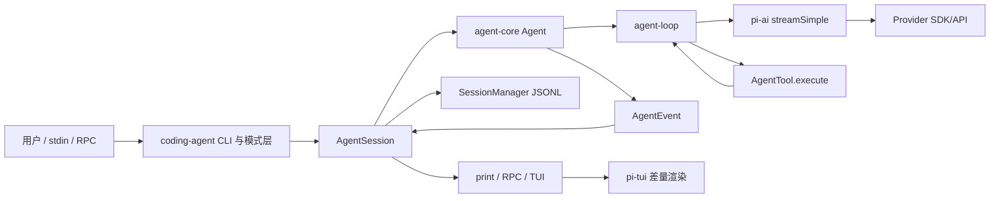
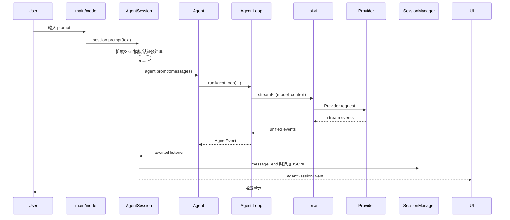
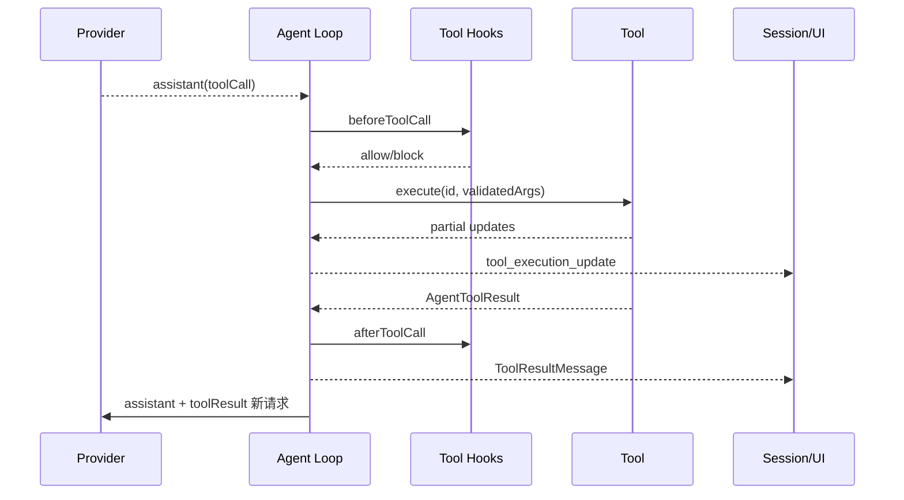
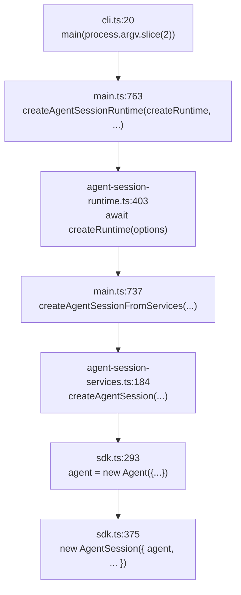
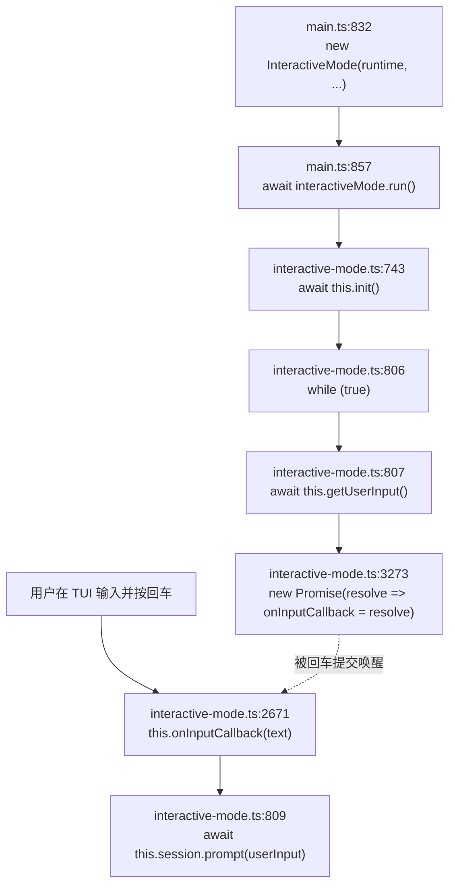
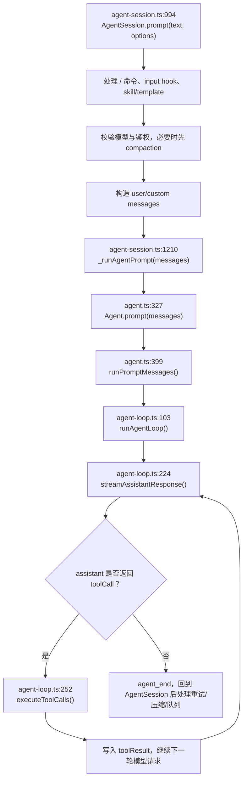

# Pi Agent 源码拆解：从 CLI 到 Agent Loop 的完整学习教程

> 源码目录：`pi-agent-study/pi`
>
> 上游仓库：`https://github.com/earendil-works/pi.git`
>
> 本地源码快照：`UPSTREAM.md` 记录的上游提交为 `130ae577acd76ea2f040f2e357b0f3e730a53883`
>
> 本文行号基于 2026-06-09 当前工作区。`packages/coding-agent/src/main.ts:543` 存在本地调试日志改动，因此后续源码变化可能导致行号漂移。

## 课程目标

学完后应能回答以下问题：

1. Pi 为什么拆成 `ai`、`agent`、`coding-agent`、`tui` 四个 package？
2. 一条用户输入怎样从 CLI 进入模型，再触发工具调用并回到模型？
3. `Agent`、`AgentSession`、`SessionManager` 分别保存什么状态？
4. Provider、工具、扩展、Skills、TUI 如何在不侵入 Agent Loop 的前提下接入？
5. Pi 如何处理流式事件、并行工具、会话分支、上下文压缩、重试和终止？
6. 如何基于这套源码设计自己的 Agent Runtime？

---

# 第一篇：入门

## 第 1 章 项目背景、技术栈与整体架构

### 1.1 知识点讲解

Pi 是一个面向编码任务的 Agent Harness。它不是单一 CLI 文件，而是一个分层 TypeScript monorepo：

| Package | 源码目录 | 核心职责 |
| --- | --- | --- |
| `@earendil-works/pi-ai` | `packages/ai` | 统一模型、消息、流事件与 Provider API |
| `@earendil-works/pi-agent-core` | `packages/agent` | Agent 状态、Agent Loop、工具调用 |
| `@earendil-works/pi-coding-agent` | `packages/coding-agent` | CLI、会话、工具、扩展、Skills、运行模式 |
| `@earendil-works/pi-tui` | `packages/tui` | 终端组件、输入、焦点与差量渲染 |

主要技术栈：

- TypeScript 5.9，ESM 模块。
- Node.js `>=22.19.0`。
- npm workspaces 管理 monorepo。
- TypeBox 描述工具参数 Schema。
- OpenAI、Anthropic、Google、Mistral、AWS Bedrock 等官方 SDK。
- 自研 `EventStream` 和 TUI，而不是依赖通用 Web UI 框架。
- JSONL 保存追加式、可分支会话树。

整体依赖方向：



关键架构判断：

- `packages/agent` 不知道“读文件”“写文件”是什么，只依赖 `AgentTool` 接口。
- `packages/agent` 不知道 OpenAI 或 Anthropic，只依赖 `StreamFn`。
- `AgentSession` 是应用层编排器，负责持久化、扩展、重试、压缩和系统提示词。
- `SessionManager` 保存历史事实，`Agent.state` 保存当前运行状态。
- TUI 只消费事件，不负责业务决策。

### 1.2 关键源码片段

**文件：`README.md:26-31`**

```md
# Pi Agent Harness Mono Repo

This is the home of the pi agent harness project including our self extensible coding agent.

* **[@earendil-works/pi-coding-agent](packages/coding-agent)**: Interactive coding agent CLI
* **[@earendil-works/pi-agent-core](packages/agent)**: Agent runtime with tool calling and state management
* **[@earendil-works/pi-ai](packages/ai)**: Unified multi-provider LLM API (OpenAI, Anthropic, Google, …)
```

**文件：`package.json:4-13`**

```json
"type": "module",
"workspaces": [
	"packages/*",
	"packages/coding-agent/examples/extensions/with-deps",
	"packages/coding-agent/examples/extensions/custom-provider-anthropic",
	"packages/coding-agent/examples/extensions/custom-provider-gitlab-duo",
	"packages/coding-agent/examples/extensions/sandbox",
	"packages/coding-agent/examples/extensions/gondolin"
],
```

### 1.3 代码解读

根项目通过 npm workspaces 把四个核心 package 和若干扩展示例纳入同一依赖图。各 package 可以独立发布，但源码开发时通过 workspace 互相引用。

`coding-agent` 是最终产品，`agent-core` 和 `ai` 是可复用内核，`tui` 是表现层。这种拆分使同一 Agent Runtime 可以被 CLI、RPC 或其他宿主复用。

### 1.4 重难点分析

**重点：** 不要把 `AgentSession` 和 `Agent` 混为一谈。前者是编码产品的应用服务，后者是通用 Agent 状态机。

**难点：** 同一个“消息”在不同层有不同语义：

- `pi-ai.Message`：Provider 可理解的标准消息。
- `AgentMessage`：标准消息加应用自定义消息。
- `SessionEntry`：带树节点元数据、用于持久化的记录。
- `AgentEvent`：描述运行过程的事件，不等于历史记录。

---

## 第 2 章 目录结构与阅读路线

### 2.1 知识点讲解

建议先按运行链路读，而不是逐目录扫文件。

```text
pi/
├── packages/
│   ├── ai/
│   │   └── src/
│   │       ├── stream.ts
│   │       ├── api-registry.ts
│   │       ├── types.ts
│   │       └── providers/
│   ├── agent/
│   │   └── src/
│   │       ├── agent.ts
│   │       ├── agent-loop.ts
│   │       └── types.ts
│   ├── coding-agent/
│   │   └── src/
│   │       ├── cli.ts
│   │       ├── main.ts
│   │       ├── core/
│   │       │   ├── sdk.ts
│   │       │   ├── agent-session.ts
│   │       │   ├── session-manager.ts
│   │       │   ├── resource-loader.ts
│   │       │   ├── extensions/
│   │       │   ├── compaction/
│   │       │   └── tools/
│   │       └── modes/
│   └── tui/
│       └── src/
│           ├── tui.ts
│           └── terminal.ts
├── pi-test.sh
├── package.json
└── AGENTS.md
```

推荐阅读顺序：

1. `cli.ts` 与 `main.ts`：理解入口和模式分派。
2. `sdk.ts`：理解对象如何组装。
3. `agent.ts`：理解状态和生命周期。
4. `agent-loop.ts`：理解 Agent 的核心循环。
5. `stream.ts` 与 Provider：理解模型边界。
6. `tools/`：理解执行能力。
7. `agent-session.ts` 与 `session-manager.ts`：理解产品级能力。
8. `extensions/`、`resource-loader.ts`、`tui.ts`：理解可扩展性和 UI。

### 2.2 关键源码片段

**文件：`packages/coding-agent/package.json:5-9`**

```json
"description": "Coding agent CLI with read, bash, edit, write tools and session management",
"type": "module",
"bin": {
	"pi": "dist/cli.js"
},
```

**文件：`packages/agent/package.json:5-11`**

```json
"description": "General-purpose agent with transport abstraction, state management, and attachment support",
"type": "module",
"exports": {
	".": {
		"types": "./dist/index.d.ts",
		"import": "./dist/index.js"
	},
```

### 2.3 代码解读

两个 package 的描述已经给出明确边界：`coding-agent` 是带具体工具和会话的产品；`agent-core` 是通用 Runtime。阅读时应始终问：“这段逻辑属于通用循环，还是编码产品策略？”

### 2.4 重难点分析

**重点：** `main.ts` 很长，但它主要是启动编排，不是 Agent 核心算法。

**难点：** `agent-session.ts` 超过三千行，适合按职责跳读：事件持久化、Prompt 预处理、工具注册、压缩、重试、扩展绑定。

---

# 第二篇：基础模块

## 第 3 章 CLI 启动、参数解析与运行模式

### 3.1 知识点讲解

源码启动链：

```text
pi-test.sh
  -> tsx
  -> packages/coding-agent/src/cli.ts
  -> main(process.argv.slice(2))
  -> parseArgs()
  -> create AgentSessionRuntime
  -> interactive / print / json / rpc
```

Pi 支持四种应用模式：

- `interactive`：TUI 交互。
- `print`：只输出最终文本。
- `json`：输出 JSON 事件流。
- `rpc`：通过 JSONL RPC 与宿主通信。

### 3.2 关键源码片段

**文件：`packages/coding-agent/src/cli.ts:8-20`**

```ts
import { APP_NAME } from "./config.ts";
import { configureHttpDispatcher } from "./core/http-dispatcher.ts";
import { main } from "./main.ts";

process.title = APP_NAME;
process.env.PI_CODING_AGENT = "true";
process.emitWarning = (() => {}) as typeof process.emitWarning;

// Configure undici's global dispatcher before provider SDKs issue requests.
// Runtime settings are applied once SettingsManager has loaded global/project settings.
configureHttpDispatcher();

main(process.argv.slice(2));
```

**文件：`packages/coding-agent/src/main.ts:98-115`**

```ts
type AppMode = "interactive" | "print" | "json" | "rpc";

function resolveAppMode(parsed: Args, stdinIsTTY: boolean): AppMode {
	if (parsed.mode === "rpc") {
		return "rpc";
	}
	if (parsed.mode === "json") {
		return "json";
	}
	if (parsed.print || !stdinIsTTY) {
		return "print";
	}
	return "interactive";
}

function toPrintOutputMode(appMode: AppMode): Exclude<Mode, "rpc"> {
	return appMode === "json" ? "json" : "text";
}
```

**文件：`packages/coding-agent/src/main.ts:824-866`**

```ts
if (appMode === "rpc") {
	printTimings();
	await runRpcMode(runtime);
} else if (appMode === "interactive") {
	const interactiveMode = new InteractiveMode(runtime, {
		migratedProviders,
		modelFallbackMessage,
		initialMessage,
		initialImages,
		initialMessages: parsed.messages,
		verbose: parsed.verbose,
	});
	if (startupBenchmark) {
		await interactiveMode.init();
		time("interactiveMode.init");
		printTimings();
		interactiveMode.stop();
		stopThemeWatcher();
		if (process.stdout.writableLength > 0) {
			await new Promise<void>((resolve) => process.stdout.once("drain", resolve));
		}
		if (process.stderr.writableLength > 0) {
			await new Promise<void>((resolve) => process.stderr.once("drain", resolve));
		}
		return;
	}

	printTimings();
	await interactiveMode.run();
} else {
	printTimings();
	const exitCode = await runPrintMode(runtime, {
		mode: toPrintOutputMode(appMode),
		messages: parsed.messages,
		initialMessage,
		initialImages,
	});
	stopThemeWatcher();
	restoreStdout();
	if (exitCode !== 0) {
		process.exitCode = exitCode;
	}
	return;
}
```

### 3.3 代码解读

`cli.ts` 只完成进程级初始化。真正的启动策略都在 `main.ts`。

模式判断把“输入是否来自 TTY”也纳入决策：即使没有显式 `-p`，管道输入也会进入 print 模式。这是 CLI 工具常见的 Unix 组合设计。

模式层共享同一个 `AgentSessionRuntime`，说明业务状态与 I/O 被解耦。Interactive、Print、RPC 的差别主要是如何提交输入和消费事件。

### 3.4 重难点分析

**重点：** `--help`、`--version`、`--list-models` 会提前退出，不会进入完整 Agent Loop。

**难点：** 启动时先确定最终 Session CWD，再加载项目级设置和扩展。恢复其他项目的会话时，不能错误使用当前 shell 目录的配置。

---

## 第 4 章 Runtime 组装：从服务到 AgentSession

### 4.1 知识点讲解

对象组装分三层：

1. `createAgentSessionServices()`：创建与 CWD 绑定的设置、认证、模型、资源服务。
2. `createAgentSession()`：创建 `Agent`，恢复历史，配置工具和 Provider Stream。
3. `AgentSessionRuntime`：持有当前 Session 和 Services，支持切换、恢复、分叉。

这种拆分解决了“会话切换后 CWD 变化”的问题：服务必须随目标会话重新创建。

### 4.2 关键源码片段

**文件：`packages/coding-agent/src/core/agent-session-services.ts:131-171`**

```ts
export async function createAgentSessionServices(
	options: CreateAgentSessionServicesOptions,
): Promise<AgentSessionServices> {
	const cwd = resolvePath(options.cwd);
	const agentDir = options.agentDir ? resolvePath(options.agentDir) : getAgentDir();
	const authStorage = options.authStorage ?? AuthStorage.create(join(agentDir, "auth.json"));
	const settingsManager = options.settingsManager ?? SettingsManager.create(cwd, agentDir);
	const modelRegistry = options.modelRegistry ?? ModelRegistry.create(authStorage, join(agentDir, "models.json"));
	const resourceLoader = new DefaultResourceLoader({
		...(options.resourceLoaderOptions ?? {}),
		cwd,
		agentDir,
		settingsManager,
	});
	await resourceLoader.reload();

	const diagnostics: AgentSessionRuntimeDiagnostic[] = [];
	const extensionsResult = resourceLoader.getExtensions();
	for (const { name, config, extensionPath } of extensionsResult.runtime.pendingProviderRegistrations) {
		try {
			modelRegistry.registerProvider(name, config);
		} catch (error) {
			const message = error instanceof Error ? error.message : String(error);
			diagnostics.push({
				type: "error",
				message: `Extension "${extensionPath}" error: ${message}`,
			});
		}
	}
	extensionsResult.runtime.pendingProviderRegistrations = [];
	diagnostics.push(...applyExtensionFlagValues(resourceLoader, options.extensionFlagValues));

	return {
		cwd,
		agentDir,
		authStorage,
		settingsManager,
		modelRegistry,
		resourceLoader,
		diagnostics,
	};
}
```

**文件：`packages/coding-agent/src/core/sdk.ts:293-359`**

```ts
agent = new Agent({
	initialState: {
		systemPrompt: "",
		model,
		thinkingLevel,
		tools: [],
	},
	convertToLlm: convertToLlmWithBlockImages,
	streamFn: async (model, context, options) => {
		const auth = await modelRegistry.getApiKeyAndHeaders(model);
		if (!auth.ok) {
			throw new Error(auth.error);
		}
		const providerRetrySettings = settingsManager.getProviderRetrySettings();
		const httpIdleTimeoutMs = settingsManager.getHttpIdleTimeoutMs();
		// SDKs treat timeout=0 as 0ms (immediate timeout), not "no timeout".
		// Use max int32 to effectively disable the timeout.
		const effectiveTimeoutMs = httpIdleTimeoutMs === 0 ? 2147483647 : httpIdleTimeoutMs;
		const timeoutMs = options?.timeoutMs ?? providerRetrySettings.timeoutMs ?? effectiveTimeoutMs;
		const websocketConnectTimeoutMs =
			options?.websocketConnectTimeoutMs ?? settingsManager.getWebSocketConnectTimeoutMs();
		return streamSimple(model, context, {
			...options,
			apiKey: auth.apiKey,
			timeoutMs,
			websocketConnectTimeoutMs,
			maxRetries: options?.maxRetries ?? providerRetrySettings.maxRetries,
			maxRetryDelayMs: options?.maxRetryDelayMs ?? providerRetrySettings.maxRetryDelayMs,
			headers: mergeProviderAttributionHeaders(
				model,
				settingsManager,
				options?.sessionId,
				auth.headers,
				options?.headers,
			),
		});
	},
	onPayload: async (payload, _model) => {
		const runner = extensionRunnerRef.current;
		if (!runner?.hasHandlers("before_provider_request")) {
			return payload;
		}
		return runner.emitBeforeProviderRequest(payload);
	},
	onResponse: async (response, _model) => {
		const runner = extensionRunnerRef.current;
		if (!runner?.hasHandlers("after_provider_response")) {
			return;
		}
		await runner.emit({
			type: "after_provider_response",
			status: response.status,
			headers: response.headers,
		});
	},
	sessionId: sessionManager.getSessionId(),
	transformContext: async (messages) => {
		const runner = extensionRunnerRef.current;
		if (!runner) return messages;
		return runner.emitContext(messages);
	},
	steeringMode: settingsManager.getSteeringMode(),
	followUpMode: settingsManager.getFollowUpMode(),
	transport: settingsManager.getTransport(),
	thinkingBudgets: settingsManager.getThinkingBudgets(),
	maxRetryDelayMs: settingsManager.getProviderRetrySettings().maxRetryDelayMs,
});
```

### 4.3 代码解读

`Agent` 构造时注入的不是某家模型 SDK，而是一个 `streamFn`。编码产品在这个函数里动态取认证信息、设置超时和重试参数，再调用 `pi-ai.streamSimple()`。

`extensionRunnerRef` 解决循环依赖：`Agent` 先创建，扩展 Runtime 后绑定；回调执行时再从 ref 中读取当前 Runner，因此扩展 reload 后无需重建 Agent。

### 4.4 重难点分析

**重点：** 依赖注入不是为了“形式优雅”，而是为了认证刷新、测试替身、扩展拦截和 Provider 无关性。

**难点：** `streamFn` 的契约要求运行期失败尽量编码为流事件；但组装层的认证失败可能直接抛错，最终由 `Agent.runWithLifecycle()` 统一转成失败消息。

---

# 第三篇：核心源码

## 第 5 章 Agent：状态容器与生命周期管理

### 5.1 知识点讲解

`Agent` 是通用状态外壳，主要职责：

- 保存 system prompt、model、tools、messages。
- 防止并发运行。
- 管理 AbortController。
- 管理 steering 和 follow-up 队列。
- 调用低层 `runAgentLoop()`。
- 将 `AgentEvent` 归约回状态并通知监听器。

### 5.2 关键源码片段

**文件：`packages/agent/src/agent.ts:324-399`**

```ts
/** Start a new prompt from text, a single message, or a batch of messages. */
async prompt(message: AgentMessage | AgentMessage[]): Promise<void>;
async prompt(input: string, images?: ImageContent[]): Promise<void>;
async prompt(input: string | AgentMessage | AgentMessage[], images?: ImageContent[]): Promise<void> {
	if (this.activeRun) {
		throw new Error(
			"Agent is already processing a prompt. Use steer() or followUp() to queue messages, or wait for completion.",
		);
	}
	const messages = this.normalizePromptInput(input, images);
	await this.runPromptMessages(messages);
}

/** Continue from the current transcript. The last message must be a user or tool-result message. */
async continue(): Promise<void> {
	if (this.activeRun) {
		throw new Error("Agent is already processing. Wait for completion before continuing.");
	}

	const lastMessage = this._state.messages[this._state.messages.length - 1];
	if (!lastMessage) {
		throw new Error("No messages to continue from");
	}

	if (lastMessage.role === "assistant") {
		const queuedSteering = this.steeringQueue.drain();
		if (queuedSteering.length > 0) {
			await this.runPromptMessages(queuedSteering, { skipInitialSteeringPoll: true });
			return;
		}

		const queuedFollowUps = this.followUpQueue.drain();
		if (queuedFollowUps.length > 0) {
			await this.runPromptMessages(queuedFollowUps);
			return;
		}

		throw new Error("Cannot continue from message role: assistant");
	}

	await this.runContinuation();
}

private normalizePromptInput(
	input: string | AgentMessage | AgentMessage[],
	images?: ImageContent[],
): AgentMessage[] {
	if (Array.isArray(input)) {
		return input;
	}

	if (typeof input !== "string") {
		return [input];
	}

	const content: Array<TextContent | ImageContent> = [{ type: "text", text: input }];
	if (images && images.length > 0) {
		content.push(...images);
	}
	return [{ role: "user", content, timestamp: Date.now() }];
}

private async runPromptMessages(
	messages: AgentMessage[],
	options: { skipInitialSteeringPoll?: boolean } = {},
): Promise<void> {
	await this.runWithLifecycle(async (signal) => {
		await runAgentLoop(
			messages,
			this.createContextSnapshot(),
			this.createLoopConfig(options),
			(event) => this.processEvents(event),
			signal,
			this.streamFn,
		);
	});
}
```

**文件：`packages/agent/src/agent.ts:451-500`**

```ts
private async runWithLifecycle(executor: (signal: AbortSignal) => Promise<void>): Promise<void> {
	if (this.activeRun) {
		throw new Error("Agent is already processing.");
	}

	const abortController = new AbortController();
	let resolvePromise = () => {};
	const promise = new Promise<void>((resolve) => {
		resolvePromise = resolve;
	});
	this.activeRun = { promise, resolve: resolvePromise, abortController };

	this._state.isStreaming = true;
	this._state.streamingMessage = undefined;
	this._state.errorMessage = undefined;

	try {
		await executor(abortController.signal);
	} catch (error) {
		await this.handleRunFailure(error, abortController.signal.aborted);
	} finally {
		this.finishRun();
	}
}

private finishRun(): void {
	this._state.isStreaming = false;
	this._state.streamingMessage = undefined;
	this._state.pendingToolCalls = new Set<string>();
	this.activeRun?.resolve();
	this.activeRun = undefined;
}
```

### 5.3 代码解读

`prompt()` 只负责规范化输入和建立运行生命周期，核心循环被委托给 `runAgentLoop()`。

`continue()` 不创建新用户消息，适用于：

- Provider 错误重试。
- 压缩后继续。
- 上次上下文以 tool result 结束。

`activeRun` 同时保存 Promise 和 AbortController，使外部既能 `abort()`，也能 `waitForIdle()`。

### 5.4 重难点分析

**重点：** Agent 不允许两个 Prompt 并发修改同一 transcript；并发输入通过队列表达。

**难点：** `agent_end` 是最后一个循环事件，但不代表立即 idle。监听器是 await 的，只有它们完成并执行 `finishRun()` 后，`waitForIdle()` 才结束。

---

## 第 6 章 Agent Loop：模型、工具与多轮循环

### 6.1 知识点讲解

Agent Loop 的一个 turn 定义为：

```text
一次 assistant 响应 + 该响应产生的全部工具调用和工具结果
```

循环包含两层：

- 内层：只要存在工具调用或 steering 消息，就继续请求模型。
- 外层：当 Agent 本应停止时，再检查 follow-up 消息。

### 6.2 关键源码片段

**文件：`packages/agent/src/agent-loop.ts:155-269`**

```ts
async function runLoop(
	initialContext: AgentContext,
	newMessages: AgentMessage[],
	initialConfig: AgentLoopConfig,
	signal: AbortSignal | undefined,
	emit: AgentEventSink,
	streamFn?: StreamFn,
): Promise<void> {
	let currentContext = initialContext;
	let config = initialConfig;
	let firstTurn = true;
	// Check for steering messages at start (user may have typed while waiting)
	let pendingMessages: AgentMessage[] = (await config.getSteeringMessages?.()) || [];

	// Outer loop: continues when queued follow-up messages arrive after agent would stop
	while (true) {
		let hasMoreToolCalls = true;

		// Inner loop: process tool calls and steering messages
		while (hasMoreToolCalls || pendingMessages.length > 0) {
			if (!firstTurn) {
				await emit({ type: "turn_start" });
			} else {
				firstTurn = false;
			}

			// Process pending messages (inject before next assistant response)
			if (pendingMessages.length > 0) {
				for (const message of pendingMessages) {
					await emit({ type: "message_start", message });
					await emit({ type: "message_end", message });
					currentContext.messages.push(message);
					newMessages.push(message);
				}
				pendingMessages = [];
			}

			// Stream assistant response
			const message = await streamAssistantResponse(currentContext, config, signal, emit, streamFn);
			newMessages.push(message);

			if (message.stopReason === "error" || message.stopReason === "aborted") {
				await emit({ type: "turn_end", message, toolResults: [] });
				await emit({ type: "agent_end", messages: newMessages });
				return;
			}

			// Check for tool calls
			const toolCalls = message.content.filter((c) => c.type === "toolCall");

			const toolResults: ToolResultMessage[] = [];
			hasMoreToolCalls = false;
			if (toolCalls.length > 0) {
				const executedToolBatch = await executeToolCalls(currentContext, message, config, signal, emit);
				toolResults.push(...executedToolBatch.messages);
				hasMoreToolCalls = !executedToolBatch.terminate;

				for (const result of toolResults) {
					currentContext.messages.push(result);
					newMessages.push(result);
				}
			}

			await emit({ type: "turn_end", message, toolResults });

			const nextTurnContext = {
				message,
				toolResults,
				context: currentContext,
				newMessages,
			};
			const nextTurnSnapshot = await config.prepareNextTurn?.(nextTurnContext);
			if (nextTurnSnapshot) {
				currentContext = nextTurnSnapshot.context ?? currentContext;
				config = {
					...config,
					model: nextTurnSnapshot.model ?? config.model,
					reasoning:
						nextTurnSnapshot.thinkingLevel === undefined
							? config.reasoning
							: nextTurnSnapshot.thinkingLevel === "off"
								? undefined
								: nextTurnSnapshot.thinkingLevel,
				};
			}

			if (
				await config.shouldStopAfterTurn?.({
					message,
					toolResults,
					context: currentContext,
					newMessages,
				})
			) {
				await emit({ type: "agent_end", messages: newMessages });
				return;
			}

			pendingMessages = (await config.getSteeringMessages?.()) || [];
		}

		// Agent would stop here. Check for follow-up messages.
		const followUpMessages = (await config.getFollowUpMessages?.()) || [];
		if (followUpMessages.length > 0) {
			// Set as pending so inner loop processes them
			pendingMessages = followUpMessages;
			continue;
		}

		// No more messages, exit
		break;
	}

	await emit({ type: "agent_end", messages: newMessages });
}
```

### 6.3 代码解读

工具调用并不是单独的外部循环，而是 assistant message 的 content block。执行后生成 `toolResult` 消息，追加到上下文，再发起下一次 Provider 请求。

停止条件不是单个 `stopReason`：

1. 响应不是 error/aborted。
2. 当前没有需要继续处理的工具调用。
3. 没有 steering。
4. 没有 follow-up。
5. `shouldStopAfterTurn` 没要求提前停止。

`prepareNextTurn` 可以在同一次 run 中替换上下文、模型或 thinking level，是动态路由和压缩恢复的重要扩展点。

### 6.4 重难点分析

**重点：** `currentContext.messages` 是下一次模型请求的完整上下文；`newMessages` 只记录本次 loop 新产生的消息，用于事件返回。

**难点：** steering 与 follow-up 的时机不同：

- steering：当前 turn 完成后立即注入，影响正在进行的任务。
- follow-up：Agent 本应停止时才注入，相当于排队的下一问。

---

## 第 7 章 流式响应与事件协议

### 7.1 知识点讲解

Pi 没有让 UI 直接读取 SDK Chunk，而是定义统一事件：

```text
start
text_start / text_delta / text_end
thinking_start / thinking_delta / thinking_end
toolcall_start / toolcall_delta / toolcall_end
done / error
```

Agent 层再把它转成：

```text
message_start
message_update
message_end
```

### 7.2 关键源码片段

**文件：`packages/agent/src/agent-loop.ts:275-368`**

```ts
async function streamAssistantResponse(
	context: AgentContext,
	config: AgentLoopConfig,
	signal: AbortSignal | undefined,
	emit: AgentEventSink,
	streamFn?: StreamFn,
): Promise<AssistantMessage> {
	// Apply context transform if configured (AgentMessage[] → AgentMessage[])
	let messages = context.messages;
	if (config.transformContext) {
		messages = await config.transformContext(messages, signal);
	}

	// Convert to LLM-compatible messages (AgentMessage[] → Message[])
	const llmMessages = await config.convertToLlm(messages);

	// Build LLM context
	const llmContext: Context = {
		systemPrompt: context.systemPrompt,
		messages: llmMessages,
		tools: context.tools,
	};

	const streamFunction = streamFn || streamSimple;

	// Resolve API key (important for expiring tokens)
	const resolvedApiKey =
		(config.getApiKey ? await config.getApiKey(config.model.provider) : undefined) || config.apiKey;

	const response = await streamFunction(config.model, llmContext, {
		...config,
		apiKey: resolvedApiKey,
		signal,
	});

	let partialMessage: AssistantMessage | null = null;
	let addedPartial = false;

	for await (const event of response) {
		switch (event.type) {
			case "start":
				partialMessage = event.partial;
				context.messages.push(partialMessage);
				addedPartial = true;
				await emit({ type: "message_start", message: { ...partialMessage } });
				break;

			case "text_start":
			case "text_delta":
			case "text_end":
			case "thinking_start":
			case "thinking_delta":
			case "thinking_end":
			case "toolcall_start":
			case "toolcall_delta":
			case "toolcall_end":
				if (partialMessage) {
					partialMessage = event.partial;
					context.messages[context.messages.length - 1] = partialMessage;
					await emit({
						type: "message_update",
						assistantMessageEvent: event,
						message: { ...partialMessage },
					});
				}
				break;

			case "done":
			case "error": {
				const finalMessage = await response.result();
				if (addedPartial) {
					context.messages[context.messages.length - 1] = finalMessage;
				} else {
					context.messages.push(finalMessage);
				}
				if (!addedPartial) {
					await emit({ type: "message_start", message: { ...finalMessage } });
				}
				await emit({ type: "message_end", message: finalMessage });
				return finalMessage;
			}
		}
	}

	const finalMessage = await response.result();
	if (addedPartial) {
		context.messages[context.messages.length - 1] = finalMessage;
	} else {
		context.messages.push(finalMessage);
		await emit({ type: "message_start", message: { ...finalMessage } });
	}
	await emit({ type: "message_end", message: finalMessage });
	return finalMessage;
}
```

### 7.3 代码解读

流式过程中，上下文末尾保存 partial assistant message，并在每个 delta 到来时替换。最终 `done/error` 再替换为完整消息。

事件携带浅拷贝 `{ ...partialMessage }`，避免监听器直接持有正在变化的顶层对象。

`response.result()` 是流的最终事实来源。即使 Provider 没有按预期发出终止事件，循环结束后仍尝试取得最终结果。

### 7.4 重难点分析

**重点：** UI 的增量渲染和业务最终状态必须来自同一事件协议，否则容易出现“屏幕显示了，但会话没保存”的分叉。

**难点：** Provider 需要保证失败也形成最终 AssistantMessage，而不是仅抛异常。这样 Agent Loop 才能正常发出 `turn_end` 和 `agent_end`。

---

## 第 8 章 工具系统：Schema、校验、Hook 与并行执行

### 8.1 知识点讲解

工具生命周期：

```text
模型生成 toolCall
-> 按 name 查找 AgentTool
-> prepareArguments 兼容修正
-> TypeBox Schema 校验
-> beforeToolCall
-> execute
-> onUpdate
-> afterToolCall
-> tool_execution_end
-> ToolResultMessage
```

工具批次默认并行，但任一工具声明 `executionMode: "sequential"` 时，整批顺序执行。

### 8.2 关键源码片段

**文件：`packages/agent/src/agent-loop.ts:373-388`**

```ts
async function executeToolCalls(
	currentContext: AgentContext,
	assistantMessage: AssistantMessage,
	config: AgentLoopConfig,
	signal: AbortSignal | undefined,
	emit: AgentEventSink,
): Promise<ExecutedToolCallBatch> {
	const toolCalls = assistantMessage.content.filter((c) => c.type === "toolCall");
	const hasSequentialToolCall = toolCalls.some(
		(tc) => currentContext.tools?.find((t) => t.name === tc.name)?.executionMode === "sequential",
	);
	if (config.toolExecution === "sequential" || hasSequentialToolCall) {
		return executeToolCallsSequential(currentContext, assistantMessage, toolCalls, config, signal, emit);
	}
	return executeToolCallsParallel(currentContext, assistantMessage, toolCalls, config, signal, emit);
}
```

**文件：`packages/agent/src/agent-loop.ts:562-625`**

```ts
async function prepareToolCall(
	currentContext: AgentContext,
	assistantMessage: AssistantMessage,
	toolCall: AgentToolCall,
	config: AgentLoopConfig,
	signal: AbortSignal | undefined,
): Promise<PreparedToolCall | ImmediateToolCallOutcome> {
	const tool = currentContext.tools?.find((t) => t.name === toolCall.name);
	if (!tool) {
		return {
			kind: "immediate",
			result: createErrorToolResult(`Tool ${toolCall.name} not found`),
			isError: true,
		};
	}

	try {
		const preparedToolCall = prepareToolCallArguments(tool, toolCall);
		const validatedArgs = validateToolArguments(tool, preparedToolCall);
		if (config.beforeToolCall) {
			const beforeResult = await config.beforeToolCall(
				{
					assistantMessage,
					toolCall,
					args: validatedArgs,
					context: currentContext,
				},
				signal,
			);
			if (signal?.aborted) {
				return {
					kind: "immediate",
					result: createErrorToolResult("Operation aborted"),
					isError: true,
				};
			}
			if (beforeResult?.block) {
				return {
					kind: "immediate",
					result: createErrorToolResult(beforeResult.reason || "Tool execution was blocked"),
					isError: true,
				};
			}
		}
		if (signal?.aborted) {
			return {
				kind: "immediate",
				result: createErrorToolResult("Operation aborted"),
				isError: true,
			};
		}
		return {
			kind: "prepared",
			toolCall,
			tool,
			args: validatedArgs,
		};
	} catch (error) {
		return {
			kind: "immediate",
			result: createErrorToolResult(error instanceof Error ? error.message : String(error)),
			isError: true,
		};
	}
}
```

**文件：`packages/coding-agent/src/core/tools/write.ts:181-225`**

```ts
export function createWriteToolDefinition(
	cwd: string,
	options?: WriteToolOptions,
): ToolDefinition<typeof writeSchema, undefined> {
	const ops = options?.operations ?? defaultWriteOperations;
	return {
		name: "write",
		label: "write",
		description:
			"Write content to a file. Creates the file if it doesn't exist, overwrites if it does. Automatically creates parent directories.",
		promptSnippet: "Create or overwrite files",
		promptGuidelines: ["Use write only for new files or complete rewrites."],
		parameters: writeSchema,
		async execute(
			_toolCallId,
			{ path, content }: { path: string; content: string },
			signal?: AbortSignal,
			_onUpdate?,
			_ctx?,
		) {
			const absolutePath = resolveToCwd(path, cwd);
			const dir = dirname(absolutePath);
			return withFileMutationQueue(absolutePath, async () => {
				// Do not reject from an abort event listener here: that would release the
				// mutation queue while an in-flight filesystem operation may still finish.
				// Checking signal.aborted after each await observes the same aborts while
				// keeping the queue locked until the current operation has settled.
				const throwIfAborted = (): void => {
					if (signal?.aborted) throw new Error("Operation aborted");
				};

				throwIfAborted();
				// Create parent directories if needed.
				await ops.mkdir(dir);
				throwIfAborted();

				// Write the file contents.
				await ops.writeFile(absolutePath, content);
				throwIfAborted();

				return {
					content: [{ type: "text", text: `Successfully wrote ${content.length} bytes to ${path}` }],
					details: undefined,
				};
			});
		},
```

### 8.3 代码解读

`AgentTool` 只关心模型可见描述、参数 Schema 和执行函数；Coding Agent 的 `ToolDefinition` 还带 TUI renderer、prompt snippet、guideline 等产品信息，最后会被包装成 `AgentTool`。

`write` 使用按文件路径串行化的 mutation queue，避免并行 tool calls 同时写同一文件。Abort 检查发生在 await 边界后，保证不会提前释放队列锁而让底层写操作继续“越过”后继任务。

### 8.4 重难点分析

**重点：** 参数校验失败也必须返回 ToolResultMessage，让模型知道工具失败并自行修正。

**难点：** 并行执行时，完成事件按真实完成顺序产生，但 ToolResultMessage 最终按 assistant 中的调用顺序追加，兼顾实时性和上下文确定性。

---

## 第 9 章 Provider 抽象与多模型统一

### 9.1 知识点讲解

`pi-ai` 的统一边界包括：

- `Model<Api>`：模型元数据和具体 API 类型。
- `Context`：system prompt、messages、tools。
- `AssistantMessageEventStream`：统一流事件。
- `ApiProvider`：`stream` 与 `streamSimple`。
- Registry：按 `model.api` 找 Provider，而不是按品牌名硬编码。

### 9.2 关键源码片段

**文件：`packages/ai/src/stream.ts:32-65`**

```ts
function resolveApiProvider(api: Api) {
	const provider = getApiProvider(api);
	if (!provider) {
		throw new Error(`No API provider registered for api: ${api}`);
	}
	return provider;
}

export function stream<TApi extends Api>(
	model: Model<TApi>,
	context: Context,
	options?: ProviderStreamOptions,
): AssistantMessageEventStream {
	const provider = resolveApiProvider(model.api);
	return provider.stream(model, context, withEnvApiKey(model, options) as StreamOptions);
}

export async function complete<TApi extends Api>(
	model: Model<TApi>,
	context: Context,
	options?: ProviderStreamOptions,
): Promise<AssistantMessage> {
	const s = stream(model, context, options);
	return s.result();
}

export function streamSimple<TApi extends Api>(
	model: Model<TApi>,
	context: Context,
	options?: SimpleStreamOptions,
): AssistantMessageEventStream {
	const provider = resolveApiProvider(model.api);
	return provider.streamSimple(model, context, withEnvApiKey(model, options));
}
```

**文件：`packages/ai/src/api-registry.ts:66-82`**

```ts
export function registerApiProvider<TApi extends Api, TOptions extends StreamOptions>(
	provider: ApiProvider<TApi, TOptions>,
	sourceId?: string,
): void {
	apiProviderRegistry.set(provider.api, {
		provider: {
			api: provider.api,
			stream: wrapStream(provider.api, provider.stream),
			streamSimple: wrapStreamSimple(provider.api, provider.streamSimple),
		},
		sourceId,
	});
}

export function getApiProvider(api: Api): ApiProviderInternal | undefined {
	return apiProviderRegistry.get(api)?.provider;
}
```

### 9.3 代码解读

`provider` 和 `api` 不是同一个概念。例如多个品牌可能兼容 OpenAI Completions API，因此分派键使用 `model.api` 更稳定。

`streamSimple` 让上层只传统一 reasoning level，Provider 内部负责把它转换为厂商的 token budget、effort 或 thinking 配置。

Provider 注册表支持 `sourceId`，扩展卸载时可以成组注销动态 Provider。

### 9.4 重难点分析

**重点：** Agent Loop 面向事件协议编程，而不是面向某个 SDK Chunk 类型编程。

**难点：** 多 Provider 统一不能只统一请求参数，还要统一 tool call ID、thinking signature、错误、usage、缓存和终止原因。

---

# 第四篇：进阶原理

## 第 10 章 AgentSession：应用层编排与事件持久化

### 10.1 知识点讲解

`AgentSession` 是全项目最关键的应用服务，它把通用 Agent 变成 Coding Agent：

- 预处理输入、Skill、Prompt Template。
- 验证模型和认证。
- 安装扩展 Hook。
- 保存消息。
- 管理工具和系统提示词。
- 自动压缩和重试。
- 对 Interactive、Print、RPC 暴露统一接口。

### 10.2 关键源码片段

**文件：`packages/coding-agent/src/core/agent-session.ts:475-547`**

```ts
/** Internal handler for agent events - shared by subscribe and reconnect */
private _handleAgentEvent = async (event: AgentEvent): Promise<void> => {
	// When a user message starts, check if it's from either queue and remove it BEFORE emitting
	// This ensures the UI sees the updated queue state
	if (event.type === "message_start" && event.message.role === "user") {
		this._overflowRecoveryAttempted = false;
		const messageText = this._getUserMessageText(event.message);
		if (messageText) {
			// Check steering queue first
			const steeringIndex = this._steeringMessages.indexOf(messageText);
			if (steeringIndex !== -1) {
				this._steeringMessages.splice(steeringIndex, 1);
				this._emitQueueUpdate();
			} else {
				// Check follow-up queue
				const followUpIndex = this._followUpMessages.indexOf(messageText);
				if (followUpIndex !== -1) {
					this._followUpMessages.splice(followUpIndex, 1);
					this._emitQueueUpdate();
				}
			}
		}
	}

	// Emit to extensions first
	await this._emitExtensionEvent(event);

	// Notify all listeners
	this._emit(event.type === "agent_end" ? { ...event, willRetry: this._willRetryAfterAgentEnd(event) } : event);

	// Handle session persistence
	if (event.type === "message_end") {
		// Check if this is a custom message from extensions
		if (event.message.role === "custom") {
			// Persist as CustomMessageEntry
			this.sessionManager.appendCustomMessageEntry(
				event.message.customType,
				event.message.content,
				event.message.display,
				event.message.details,
			);
		} else if (
			event.message.role === "user" ||
			event.message.role === "assistant" ||
			event.message.role === "toolResult"
		) {
			// Regular LLM message - persist as SessionMessageEntry
			this.sessionManager.appendMessage(event.message);
		}
		// Other message types (bashExecution, compactionSummary, branchSummary) are persisted elsewhere

		// Track assistant message for auto-compaction (checked on agent_end)
		if (event.message.role === "assistant") {
			this._lastAssistantMessage = event.message;

			const assistantMsg = event.message as AssistantMessage;
			if (assistantMsg.stopReason !== "error") {
				this._overflowRecoveryAttempted = false;
			}

			// Reset retry counter immediately on successful assistant response
			// This prevents accumulation across multiple LLM calls within a turn
			if (assistantMsg.stopReason !== "error" && this._retryAttempt > 0) {
				this._emit({
					type: "auto_retry_end",
					success: true,
					attempt: this._retryAttempt,
				});
				this._retryAttempt = 0;
			}
		}
	}
};
```

**文件：`packages/coding-agent/src/core/agent-session.ts:986-1044`**

```ts
async prompt(text: string, options?: PromptOptions): Promise<void> {
	const expandPromptTemplates = options?.expandPromptTemplates ?? true;
	const preflightResult = options?.preflightResult;
	let messages: AgentMessage[] | undefined;

	try {
		// Handle extension commands first (execute immediately, even during streaming)
		// Extension commands manage their own LLM interaction via pi.sendMessage()
		if (expandPromptTemplates && text.startsWith("/")) {
			const handled = await this._tryExecuteExtensionCommand(text);
			if (handled) {
				// Extension command executed, no prompt to send
				preflightResult?.(true);
				return;
			}
		}

		// Emit input event for extension interception (before skill/template expansion)
		let currentText = text;
		let currentImages = options?.images;
		if (this._extensionRunner.hasHandlers("input")) {
			const inputResult = await this._extensionRunner.emitInput(
				currentText,
				currentImages,
				options?.source ?? "interactive",
				this.isStreaming ? options?.streamingBehavior : undefined,
			);
			if (inputResult.action === "handled") {
				preflightResult?.(true);
				return;
			}
			if (inputResult.action === "transform") {
				currentText = inputResult.text;
				currentImages = inputResult.images ?? currentImages;
			}
		}

		// Expand skill commands (/skill:name args) and prompt templates (/template args)
		let expandedText = currentText;
		if (expandPromptTemplates) {
			expandedText = this._expandSkillCommand(expandedText);
			expandedText = expandPromptTemplate(expandedText, [...this.promptTemplates]);
		}

		// If streaming, queue via steer() or followUp() based on option
		if (this.isStreaming) {
			if (!options?.streamingBehavior) {
				throw new Error(
					"Agent is already processing. Specify streamingBehavior ('steer' or 'followUp') to queue the message.",
				);
			}
			if (options.streamingBehavior === "followUp") {
				await this._queueFollowUp(expandedText, currentImages);
			} else {
				await this._queueSteer(expandedText, currentImages);
			}
			preflightResult?.(true);
			return;
		}
```

### 10.3 代码解读

事件先交给扩展，再交给 UI 监听器，最后持久化。`message_end` 才保存消息，避免把每个流式 partial 都写入磁盘。

Prompt 处理顺序是架构契约：

```text
扩展命令
-> input hook
-> Skill / Template 展开
-> streaming queue
-> 模型与认证检查
-> 压缩检查
-> before_agent_start
-> Agent.prompt
```

### 10.4 重难点分析

**重点：** 业务层通过监听通用事件增加功能，而不是修改 Agent Loop。

**难点：** 扩展 `message_end` 可以替换消息。代码必须让 Agent state、后续事件和持久化看到同一个替换结果，因此采用原对象就地修改。

---

## 第 11 章 SessionManager：JSONL、追加式树与分支会话

### 11.1 知识点讲解

Pi 的 Session 不是简单消息数组，而是追加式树：

- 每个 Entry 有 `id` 和 `parentId`。
- `leafId` 表示当前分支末端。
- 新消息成为当前 leaf 的子节点。
- 回到历史节点后继续追加即可形成分支。
- JSONL 每行一个记录，便于增量写入和恢复。

### 11.2 关键源码片段

**文件：`packages/coding-agent/src/core/session-manager.ts:30-78`**

```ts
export const CURRENT_SESSION_VERSION = 3;

export interface SessionHeader {
	type: "session";
	version?: number; // v1 sessions don't have this
	id: string;
	timestamp: string;
	cwd: string;
	parentSession?: string;
}

export interface NewSessionOptions {
	id?: string;
	parentSession?: string;
}

export interface SessionEntryBase {
	type: string;
	id: string;
	parentId: string | null;
	timestamp: string;
}

export interface SessionMessageEntry extends SessionEntryBase {
	type: "message";
	message: AgentMessage;
}

export interface ThinkingLevelChangeEntry extends SessionEntryBase {
	type: "thinking_level_change";
	thinkingLevel: string;
}

export interface ModelChangeEntry extends SessionEntryBase {
	type: "model_change";
	provider: string;
	modelId: string;
}

export interface CompactionEntry<T = unknown> extends SessionEntryBase {
	type: "compaction";
	summary: string;
	firstKeptEntryId: string;
	tokensBefore: number;
	/** Extension-specific data (e.g., ArtifactIndex, version markers for structured compaction) */
	details?: T;
	/** True if generated by an extension, undefined/false if pi-generated (backward compatible) */
	fromHook?: boolean;
}
```

**文件：`packages/coding-agent/src/core/session-manager.ts:325-431`**

```ts
export function buildSessionContext(
	entries: SessionEntry[],
	leafId?: string | null,
	byId?: Map<string, SessionEntry>,
): SessionContext {
	// Build uuid index if not available
	if (!byId) {
		byId = new Map<string, SessionEntry>();
		for (const entry of entries) {
			byId.set(entry.id, entry);
		}
	}

	// Find leaf
	let leaf: SessionEntry | undefined;
	if (leafId === null) {
		// Explicitly null - return no messages (navigated to before first entry)
		return { messages: [], thinkingLevel: "off", model: null };
	}
	if (leafId) {
		leaf = byId.get(leafId);
	}
	if (!leaf) {
		// Fallback to last entry (when leafId is undefined)
		leaf = entries[entries.length - 1];
	}

	if (!leaf) {
		return { messages: [], thinkingLevel: "off", model: null };
	}

	// Walk from leaf to root, collecting path
	const path: SessionEntry[] = [];
	let current: SessionEntry | undefined = leaf;
	while (current) {
		path.unshift(current);
		current = current.parentId ? byId.get(current.parentId) : undefined;
	}

	// Extract settings and find compaction
	let thinkingLevel = "off";
	let model: { provider: string; modelId: string } | null = null;
	let compaction: CompactionEntry | null = null;

	for (const entry of path) {
		if (entry.type === "thinking_level_change") {
			thinkingLevel = entry.thinkingLevel;
		} else if (entry.type === "model_change") {
			model = { provider: entry.provider, modelId: entry.modelId };
		} else if (entry.type === "message" && entry.message.role === "assistant") {
			model = { provider: entry.message.provider, modelId: entry.message.model };
		} else if (entry.type === "compaction") {
			compaction = entry;
		}
	}

	const messages: AgentMessage[] = [];

	const appendMessage = (entry: SessionEntry) => {
		if (entry.type === "message") {
			messages.push(entry.message);
		} else if (entry.type === "custom_message") {
			messages.push(
				createCustomMessage(entry.customType, entry.content, entry.display, entry.details, entry.timestamp),
			);
		} else if (entry.type === "branch_summary" && entry.summary) {
			messages.push(createBranchSummaryMessage(entry.summary, entry.fromId, entry.timestamp));
		}
	};

	if (compaction) {
		// Emit summary first
		messages.push(createCompactionSummaryMessage(compaction.summary, compaction.tokensBefore, compaction.timestamp));

		// Find compaction index in path
		const compactionIdx = path.findIndex((e) => e.type === "compaction" && e.id === compaction.id);

		// Emit kept messages (before compaction, starting from firstKeptEntryId)
		let foundFirstKept = false;
		for (let i = 0; i < compactionIdx; i++) {
			const entry = path[i];
			if (entry.id === compaction.firstKeptEntryId) {
				foundFirstKept = true;
			}
			if (foundFirstKept) {
				appendMessage(entry);
			}
		}

		// Emit messages after compaction
		for (let i = compactionIdx + 1; i < path.length; i++) {
			const entry = path[i];
			appendMessage(entry);
		}
	} else {
		// No compaction - emit all messages, handle branch summaries and custom messages
		for (const entry of path) {
			appendMessage(entry);
		}
	}

	return { messages, thinkingLevel, model };
}
```

### 11.3 代码解读

恢复上下文时先从 leaf 沿 `parentId` 回溯到根，只选择当前分支。模型和 thinking level 也作为 Entry 进入历史，因此恢复会话可以重建运行配置。

压缩并不删除旧节点。`buildSessionContext()` 在看到 compaction entry 后，用 summary 替换旧历史，同时保留最近消息。

### 11.4 重难点分析

**重点：** Session 文件是事件/事实日志，LLM Context 是从日志投影出来的视图。

**难点：** 追加式树比覆盖式消息数组更容易审计和分叉，但读取时必须正确处理迁移、损坏行、compaction boundary 和自定义 Entry。

---

## 第 12 章 系统提示词、项目上下文与 Skills

### 12.1 知识点讲解

系统提示词由运行时动态构建，输入包括：

- 当前启用工具及其 prompt snippet。
- 工具使用 guideline。
- 自定义 system prompt 和 append prompt。
- 全局与项目目录中的 `AGENTS.md` / `CLAUDE.md`。
- 已加载 Skills。
- 当前日期和 CWD。

工具集合变化时，系统提示词也会重建，避免提示模型使用不存在的工具。

### 12.2 关键源码片段

**文件：`packages/coding-agent/src/core/agent-session.ts:896-929`**

```ts
private _rebuildSystemPrompt(toolNames: string[]): string {
	const validToolNames = toolNames.filter((name) => this._toolRegistry.has(name));
	const toolSnippets: Record<string, string> = {};
	const promptGuidelines: string[] = [];
	for (const name of validToolNames) {
		const snippet = this._toolPromptSnippets.get(name);
		if (snippet) {
			toolSnippets[name] = snippet;
		}

		const toolGuidelines = this._toolPromptGuidelines.get(name);
		if (toolGuidelines) {
			promptGuidelines.push(...toolGuidelines);
		}
	}

	const loaderSystemPrompt = this._resourceLoader.getSystemPrompt();
	const loaderAppendSystemPrompt = this._resourceLoader.getAppendSystemPrompt();
	const appendSystemPrompt =
		loaderAppendSystemPrompt.length > 0 ? loaderAppendSystemPrompt.join("\n\n") : undefined;
	const loadedSkills = this._resourceLoader.getSkills().skills;
	const loadedContextFiles = this._resourceLoader.getAgentsFiles().agentsFiles;

	this._baseSystemPromptOptions = {
		cwd: this._cwd,
		skills: loadedSkills,
		contextFiles: loadedContextFiles,
		customPrompt: loaderSystemPrompt,
		appendSystemPrompt,
		selectedTools: validToolNames,
		toolSnippets,
		promptGuidelines,
	};
	return buildSystemPrompt(this._baseSystemPromptOptions);
}
```

**文件：`packages/coding-agent/src/core/resource-loader.ts:75-116`**

```ts
export function loadProjectContextFiles(options: {
	cwd: string;
	agentDir: string;
	projectTrusted?: boolean;
}): Array<{ path: string; content: string }> {
	const resolvedCwd = resolvePath(options.cwd);
	const resolvedAgentDir = resolvePath(options.agentDir);

	const contextFiles: Array<{ path: string; content: string }> = [];
	const seenPaths = new Set<string>();

	const globalContext = loadContextFileFromDir(resolvedAgentDir);
	if (globalContext) {
		contextFiles.push(globalContext);
		seenPaths.add(globalContext.path);
	}

	if (options.projectTrusted !== false) {
		const ancestorContextFiles: Array<{ path: string; content: string }> = [];

		let currentDir = resolvedCwd;
		const root = resolve("/");

		while (true) {
			const contextFile = loadContextFileFromDir(currentDir);
			if (contextFile && !seenPaths.has(contextFile.path)) {
				ancestorContextFiles.unshift(contextFile);
				seenPaths.add(contextFile.path);
			}

			if (currentDir === root) break;

			const parentDir = resolve(currentDir, "..");
			if (parentDir === currentDir) break;
			currentDir = parentDir;
		}

		contextFiles.push(...ancestorContextFiles);
	}

	return contextFiles;
}
```

### 12.3 代码解读

项目上下文从 CWD 向根目录逐级查找，并通过 `unshift` 保证上层规则先出现、近层规则后出现。项目未被信任时，不加载本地上下文和资源。

Skill 本质是按需展开的知识/工作流资源。它不应全部塞进初始 Prompt，而是先暴露索引，调用时再读取具体内容。

### 12.4 重难点分析

**重点：** Prompt 是运行时配置的投影，不是固定常量。

**难点：** 可扩展 Prompt 必须与工具注册表保持一致，否则模型会产生不存在的工具调用。

---

## 第 13 章 扩展系统：事件总线与开放式能力注入

### 13.1 知识点讲解

扩展可以：

- 监听 Agent、Turn、Message、Tool 生命周期。
- 注册工具、命令、快捷键和 CLI Flag。
- 修改输入、上下文、Provider Payload、最终消息。
- 注册自定义 Provider。
- 提供 TUI 组件。
- 拦截会话切换、分叉和压缩。

扩展不是直接拿到 Agent 内部字段，而是通过 `ExtensionContext` 和绑定的 actions 操作宿主。

### 13.2 关键源码片段

**文件：`packages/coding-agent/src/core/extensions/types.ts:1-9`**

```ts
/**
 * Extension system types.
 *
 * Extensions are TypeScript modules that can:
 * - Subscribe to agent lifecycle events
 * - Register LLM-callable tools
 * - Register commands, keyboard shortcuts, and CLI flags
 * - Interact with the user via UI primitives
 */
```

**文件：`packages/coding-agent/src/core/agent-session.ts:403-450`**

```ts
private _installAgentToolHooks(): void {
	this.agent.beforeToolCall = async ({ toolCall, args }) => {
		const runner = this._extensionRunner;
		if (!runner.hasHandlers("tool_call")) {
			return undefined;
		}

		try {
			return await runner.emitToolCall({
				type: "tool_call",
				toolName: toolCall.name,
				toolCallId: toolCall.id,
				input: args as Record<string, unknown>,
			});
		} catch (err) {
			if (err instanceof Error) {
				throw err;
			}
			throw new Error(`Extension failed, blocking execution: ${String(err)}`);
		}
	};

	this.agent.afterToolCall = async ({ toolCall, args, result, isError }) => {
		const runner = this._extensionRunner;
		if (!runner.hasHandlers("tool_result")) {
			return undefined;
		}

		const hookResult = await runner.emitToolResult({
			type: "tool_result",
			toolName: toolCall.name,
			toolCallId: toolCall.id,
			input: args as Record<string, unknown>,
			content: result.content,
			details: result.details,
			isError,
		});

		if (!hookResult) {
			return undefined;
		}

		return {
			content: hookResult.content,
			details: hookResult.details,
			isError: hookResult.isError ?? isError,
		};
	};
}
```

### 13.3 代码解读

安全拦截点位于 Schema 校验之后、实际执行之前，因此扩展看到的是已验证参数。`tool_result` 又允许扩展脱敏或替换结果。

扩展 Runner 使用绑定动作而不是导入具体 Session 实现，降低插件 API 与内部类的耦合。

### 13.4 重难点分析

**重点：** Hook 的位置决定能力边界。输入前、Provider 前、工具前、工具后、消息结束后分别适合不同用途。

**难点：** Reload 或 Session 替换后，旧 Extension Context 必须失效，否则扩展可能继续操作已经释放的 Session。

---

## 第 14 章 上下文压缩、错误恢复与自动重试

### 14.1 知识点讲解

长会话需要同时解决两个问题：

- Context 接近窗口上限：生成摘要并保留近期消息。
- Provider 暂时失败：指数退避后继续当前上下文。

二者不能混用：

- Context overflow 交给 compaction。
- 429、5xx、网络错误交给 retry。
- 额度或账单错误不应自动重试。

### 14.2 关键源码片段

**文件：`packages/coding-agent/src/core/compaction/compaction.ts:115-125`**

```ts
export interface CompactionSettings {
	enabled: boolean;
	reserveTokens: number;
	keepRecentTokens: number;
}

export const DEFAULT_COMPACTION_SETTINGS: CompactionSettings = {
	enabled: true,
	reserveTokens: 16384,
	keepRecentTokens: 20000,
};
```

**文件：`packages/coding-agent/src/core/compaction/compaction.ts:216-222`**

```ts
/**
 * Check if compaction should trigger based on context usage.
 */
export function shouldCompact(contextTokens: number, contextWindow: number, settings: CompactionSettings): boolean {
	if (!settings.enabled) return false;
	return contextTokens > contextWindow - settings.reserveTokens;
}
```

**文件：`packages/coding-agent/src/core/agent-session.ts:2462-2478`**

```ts
/**
 * Check if an error is retryable (overloaded, rate limit, server errors).
 * Context overflow errors are NOT retryable (handled by compaction instead).
 */
private _isRetryableError(message: AssistantMessage): boolean {
	if (message.stopReason !== "error" || !message.errorMessage) return false;

	// Context overflow is handled by compaction, not retry
	const contextWindow = this.model?.contextWindow ?? 0;
	if (isContextOverflow(message, contextWindow)) return false;

	const err = message.errorMessage;
	if (this._isNonRetryableProviderLimitError(err)) return false;
	// Match: overloaded_error, provider returned error, rate limit, 429, 500, 502, 503, 504, service unavailable, network/connection errors (including connection lost), WebSocket transport closes/errors, fetch failed, premature stream endings, HTTP/2 closed before response, terminated, retry delay exceeded
	return /overloaded|provider.?returned.?error|rate.?limit|too many requests|429|500|502|503|504|service.?unavailable|server.?error|internal.?error|network.?error|connection.?error|connection.?refused|connection.?lost|websocket.?closed|websocket.?error|other side closed|fetch failed|upstream.?connect|reset before headers|socket hang up|ended without|stream ended before message_stop|http2 request did not get a response|timed? out|timeout|terminated|retry delay/i.test(
		err,
	);
}
```

**文件：`packages/coding-agent/src/core/agent-session.ts:2491-2534`**

```ts
this._retryAttempt++;

if (this._retryAttempt > settings.maxRetries) {
	// Preserve the completed attempt count so post-run handling can emit the final failure.
	this._retryAttempt--;
	return false;
}

const delayMs = settings.baseDelayMs * 2 ** (this._retryAttempt - 1);

this._emit({
	type: "auto_retry_start",
	attempt: this._retryAttempt,
	maxAttempts: settings.maxRetries,
	delayMs,
	errorMessage: message.errorMessage || "Unknown error",
});

// Remove error message from agent state (keep in session for history)
const messages = this.agent.state.messages;
if (messages.length > 0 && messages[messages.length - 1].role === "assistant") {
	this.agent.state.messages = messages.slice(0, -1);
}

// Wait with exponential backoff (abortable)
this._retryAbortController = new AbortController();
try {
	await sleep(delayMs, this._retryAbortController.signal);
} catch {
	// Aborted during sleep - emit end event so UI can clean up
	const attempt = this._retryAttempt;
	this._retryAttempt = 0;
	this._emit({
		type: "auto_retry_end",
		success: false,
		attempt,
		finalError: "Retry cancelled",
	});
	return false;
} finally {
	this._retryAbortController = undefined;
}

return true;
```

### 14.3 代码解读

压缩阈值不是等到 100% 才触发，而是为下一次输出预留 `reserveTokens`。

重试时错误消息保留在 Session 历史中用于审计，但从当前 Agent Context 末尾移除，然后使用 `continue()` 重新请求，避免把错误 assistant message 当成有效上下文。

### 14.4 重难点分析

**重点：** “持久化历史”和“下一次模型上下文”可以不同，这是恢复策略的基础。

**难点：** 压缩切点不能落在 tool result 上，否则会留下没有 tool call 的孤立结果。源码专门只选择 user、assistant、custom 等合法边界。

---

## 第 15 章 TUI：事件驱动与差量渲染

### 15.1 知识点讲解

TUI 分两层：

- `InteractiveMode`：将 AgentSessionEvent 映射为组件状态。
- `pi-tui.TUI`：把组件树渲染为行，并只更新变化区域。

组件只需实现：

- `render(width): string[]`
- 可选 `handleInput(data)`
- `invalidate()`

### 15.2 关键源码片段

**文件：`packages/tui/src/tui.ts:36-63`**

```ts
/**
 * Component interface - all components must implement this
 */
export interface Component {
	/**
	 * Render the component to lines for the given viewport width
	 * @param width - Current viewport width
	 * @returns Array of strings, each representing a line
	 */
	render(width: number): string[];

	/**
	 * Optional handler for keyboard input when component has focus
	 */
	handleInput?(data: string): void;

	/**
	 * If true, component receives key release events (Kitty protocol).
	 * Default is false - release events are filtered out.
	 */
	wantsKeyRelease?: boolean;

	/**
	 * Invalidate any cached rendering state.
	 * Called when theme changes or when component needs to re-render from scratch.
	 */
	invalidate(): void;
}
```

**文件：`packages/tui/src/tui.ts:262-280`**

```ts
/**
 * TUI - Main class for managing terminal UI with differential rendering
 */
export class TUI extends Container {
	public terminal: Terminal;
	private previousLines: string[] = [];
	private previousKittyImageIds = new Set<number>();
	private previousWidth = 0;
	private previousHeight = 0;
	private focusedComponent: Component | null = null;
	private inputListeners = new Set<InputListener>();

	/** Global callback for debug key (Shift+Ctrl+D). Called before input is forwarded to focused component. */
	public onDebug?: () => void;
	private renderRequested = false;
	private renderTimer: NodeJS.Timeout | undefined;
	private lastRenderAt = 0;
	private static readonly MIN_RENDER_INTERVAL_MS = 16;
	private cursorRow = 0; // Logical cursor row (end of rendered content)
```

### 15.3 代码解读

TUI 保存 `previousLines`，因此可以比较新旧输出，只移动光标并更新变化行。`MIN_RENDER_INTERVAL_MS = 16` 将频繁 token delta 合并到约 60 FPS 的刷新节奏。

InteractiveMode 在收到 `message_update`、`tool_execution_update` 等事件时更新组件并调用 `requestRender()`，它不需要理解 Provider SDK。

### 15.4 重难点分析

**重点：** 流式 Agent UI 的核心不是“不断 console.log”，而是可更新组件和稳定事件 ID。

**难点：** ANSI 样式、东亚字符宽度、终端 resize、硬件光标、Kitty 图片和键盘协议都会影响差量算法。

---

# 第五篇：总结与实践

## 第 16 章 完整业务流程复盘

### 16.1 知识点讲解

#### 16.1.1 一次普通文本请求



#### 16.1.2 一次工具调用请求



### 16.2 关键源码片段

**文件：`packages/coding-agent/src/modes/print-mode.ts:119-143`**

```ts
await rebindSession();

if (initialMessage) {
	await session.prompt(initialMessage, { images: initialImages });
}

for (const message of messages) {
	await session.prompt(message);
}

if (mode === "text") {
	const state = session.state;
	const lastMessage = state.messages[state.messages.length - 1];

	if (lastMessage?.role === "assistant") {
		const assistantMsg = lastMessage as AssistantMessage;
		if (assistantMsg.stopReason === "error" || assistantMsg.stopReason === "aborted") {
			console.error(assistantMsg.errorMessage || `Request ${assistantMsg.stopReason}`);
			exitCode = 1;
		} else {
			for (const content of assistantMsg.content) {
				if (content.type === "text") {
					writeRawStdout(`${content.text}\n`);
				}
			}
		}
	}
}
```

### 16.3 代码解读

Print Mode 没有实现另一套 Agent 逻辑。它只绑定 Session、调用 `session.prompt()`，然后从统一 Agent State 中取最终 AssistantMessage。这证明 Interactive、Print 和 RPC 的区别位于输入输出适配层。

### 16.4 重难点分析

#### 架构优点

- Provider、Agent Loop、产品策略、UI 分层清晰。
- 所有运行过程有统一事件协议。
- 工具和 Provider 都可以替换与扩展。
- JSONL 追加式树保留完整历史，适合分支和审计。
- Context 压缩不会破坏原始历史。
- Interactive、Print、RPC 共享同一 Session 业务层。

#### 架构代价

- `AgentSession` 职责非常多，学习和维护成本高。
- 扩展 Hook 顺序是隐含契约，组合复杂。
- Provider 统一层要处理大量厂商差异。
- 流式事件、状态、持久化三者一致性要求高。
- 会话树、压缩和分叉使恢复逻辑复杂。

---

## 第 17 章 面试表达与迁移设计

### 17.1 知识点讲解

#### 17.1.1 60 秒项目介绍

Pi Agent 是一个 TypeScript monorepo 的编码 Agent Harness。它把系统拆成四层：`pi-ai` 统一多模型 Provider 和流事件，`agent-core` 实现状态化 Agent 与 tool-calling loop，`coding-agent` 负责 CLI、Session、工具、扩展、上下文压缩和重试，`pi-tui` 负责终端差量渲染。一次请求由 AgentSession 完成输入预处理，再进入 Agent Loop；模型返回 tool call 后，Runtime 校验参数、执行工具、把 tool result 追加回上下文并继续请求，直到没有工具或排队消息。会话以追加式 JSONL 树保存，因此支持恢复、分叉和压缩而不破坏原历史。

#### 17.1.2 典型深挖问题

**为什么 Agent Loop 不直接调用 OpenAI SDK？**

因为它只依赖 `StreamFn` 和统一事件协议，从而支持 Provider 替换、测试、认证刷新和动态扩展。

**为什么要区分 Agent 与 AgentSession？**

Agent 只处理通用运行状态和循环；AgentSession 承担编码产品策略，避免把持久化、Skills、TUI 和项目规则污染通用内核。

**如何保证工具调用安全？**

工具参数先经过 Schema 校验，再进入 `beforeToolCall` Hook；应用可以阻止执行。结果还会经过 `afterToolCall`，可脱敏或重写。但 Pi 默认没有内置操作系统权限沙箱，强隔离要靠容器或 Sandbox。

**如何支持用户在生成过程中追加要求？**

使用 steering queue。当前 turn 和工具执行完成后，队列消息会在下一次模型请求前注入；follow-up 则只在 Agent 本应停止后执行。

### 17.2 关键源码片段

**文件：`packages/coding-agent/src/core/session-manager.ts:944-960`**

```ts
/** Append a message as child of current leaf, then advance leaf. Returns entry id.
 * Does not allow writing CompactionSummaryMessage and BranchSummaryMessage directly.
 * Reason: we want these to be top-level entries in the session, not message session entries,
 * so it is easier to find them.
 * These need to be appended via appendCompaction() and appendBranchSummary() methods.
 */
appendMessage(message: Message | CustomMessage | BashExecutionMessage): string {
	const entry: SessionMessageEntry = {
		type: "message",
		id: generateId(this.byId),
		parentId: this.leafId,
		timestamp: new Date().toISOString(),
		message,
	};
	this._appendEntry(entry);
	return entry.id;
}
```

### 17.3 代码解读

这段代码适合用来解释 Pi 的工程取舍：消息不是覆盖写入数组，而是追加为当前 leaf 的子节点。迁移到自己的 Agent 时，优先复用这种“事实日志 + Context 投影”思想，而不是照搬全部 UI 和扩展代码。

### 17.4 重难点分析

#### 自建 Agent 的最小模块

可以从 Pi 提炼为七个模块：

1. `Message/Model/Tool` 统一类型。
2. Provider Registry 与统一 Stream。
3. Agent Loop。
4. Agent 状态与 Abort/Queue。
5. 应用 Session 编排。
6. 追加式持久化与 Context Projection。
7. UI/RPC 事件消费者。

不要一开始复制全部扩展、分支和 TUI。先实现：

```text
prompt
-> stream assistant
-> detect tool call
-> validate and execute
-> append tool result
-> continue
-> persist final messages
```

---

## 第 18 章 调试实验与学习验收

### 18.1 知识点讲解

调试应从最短路径逐步进入复杂路径：先验证 CLI 短路命令，再验证普通模型请求，最后验证工具、分叉、压缩和扩展。不要一开始就在 InteractiveMode 中追踪全部事件。

#### 推荐断点

| 目标 | 文件与行号 |
| --- | --- |
| CLI 入口 | `packages/coding-agent/src/cli.ts:20` |
| 模式分派 | `packages/coding-agent/src/main.ts:824` |
| Agent 创建 | `packages/coding-agent/src/core/sdk.ts:293` |
| Session Prompt | `packages/coding-agent/src/core/agent-session.ts:986` |
| Agent Prompt | `packages/agent/src/agent.ts:327` |
| Loop 主体 | `packages/agent/src/agent-loop.ts:155` |
| Provider 请求 | `packages/agent/src/agent-loop.ts:304` |
| 工具准备 | `packages/agent/src/agent-loop.ts:562` |
| 消息持久化 | `packages/coding-agent/src/core/agent-session.ts:505` |
| JSONL Context 投影 | `packages/coding-agent/src/core/session-manager.ts:325` |

### 18.2 关键源码片段

**文件：`pi-test.sh:1-4`**

```bash
#!/usr/bin/env bash
set -euo pipefail

SCRIPT_DIR="$(cd "$(dirname "${BASH_SOURCE[0]}")" && pwd)"
```

**文件：`pi-test.sh:57`**

```bash
"$SCRIPT_DIR/node_modules/.bin/tsx" --tsconfig "$SCRIPT_DIR/tsconfig.json" "$SCRIPT_DIR/packages/coding-agent/src/cli.ts" ${ARGS[@]+"${ARGS[@]}"}
```

### 18.3 代码解读

`pi-test.sh` 不依赖构建产物，而是使用本地 `tsx` 直接执行 TypeScript CLI 入口。因此断点、临时日志和源码修改可以立即生效，适合源码学习。

### 18.4 重难点分析

#### 建议实验

1. 使用 `./pi-test.sh --help`，确认只经过入口和参数处理。
2. 使用 print 模式提交简单 Prompt，观察 `agent_start -> turn_start -> message_* -> turn_end -> agent_end`。
3. 用 faux Provider 返回固定 tool call，观察第二次 Provider 请求包含 tool result。
4. 将两个只读工具设为并行，记录 `tool_execution_end` 完成顺序与 ToolResultMessage 顺序。
5. 创建 Session 后分叉，检查 JSONL 中 `parentId`。
6. 降低压缩阈值，验证 compaction entry 和恢复后的 Context。
7. 编写扩展拦截 `tool_call`，阻止 write，验证模型收到错误 ToolResult。

#### 验收清单

- [ ] 能画出 CLI 到 Provider 的完整调用链。
- [ ] 能解释 `Agent` 与 `AgentSession` 的边界。
- [ ] 能说清内外两层 Agent Loop。
- [ ] 能解释工具参数校验、Hook、并行与结果排序。
- [ ] 能解释 `AgentMessage`、`Message`、`SessionEntry`、`AgentEvent`。
- [ ] 能解释 Session 为什么是树而不是数组。
- [ ] 能解释 compaction 为什么不删除历史。
- [ ] 能说明扩展系统的主要切入点。
- [ ] 能说明 TUI 为什么必须基于事件与差量渲染。
- [ ] 能指出默认权限模型的风险与隔离方式。

---

## 附录 0：常见调试问答

### Q1：`sdk.ts:293` 的 `agent = new Agent({...})` 是怎么被调用到的？

`new Agent()` 发生在 CLI 启动、构造 `AgentSessionRuntime` 的阶段，不是用户输入 prompt 后才创建。



核心代码引用：

```ts
// packages/coding-agent/src/main.ts:763
const runtime = await createAgentSessionRuntime(createRuntime, {
	cwd: sessionManager.getCwd(),
	agentDir,
	sessionManager,
});
```

```ts
// packages/coding-agent/src/core/agent-session-runtime.ts:403
const result = await createRuntime(options);
```

```ts
// packages/coding-agent/src/core/sdk.ts:293
agent = new Agent({
	initialState: {
		systemPrompt: "",
		model,
		thinkingLevel,
		tools: [],
	},
	convertToLlm: convertToLlmWithBlockImages,
	streamFn: async (model, context, options) => {
		// ...
	},
});
```

结论：`Agent` 是启动时创建好的运行对象；用户输入后调用的是这个对象上的 `agent.prompt()`。

### Q2：启动创建完 `AgentSession` 后，怎么走到 `session.prompt()`？中间停在哪里？

Interactive 模式下，创建完 Session 后会进入 TUI 主循环，真正等待的位置是 `await this.getUserInput()`。



核心代码引用：

```ts
// packages/coding-agent/src/modes/interactive/interactive-mode.ts:805
while (true) {
	const userInput = await this.getUserInput();
	try {
		await this.session.prompt(userInput);
	} catch (error: unknown) {
		const errorMessage = error instanceof Error ? error.message : "Unknown error occurred";
		this.showError(errorMessage);
	}
}
```

```ts
// packages/coding-agent/src/modes/interactive/interactive-mode.ts:3267
async getUserInput(): Promise<string> {
	const queuedInput = this.pendingUserInputs.shift();
	if (queuedInput !== undefined) {
		return queuedInput;
	}

	return new Promise((resolve) => {
		this.onInputCallback = (text: string) => {
			this.onInputCallback = undefined;
			resolve(text);
		};
	});
}
```

```ts
// packages/coding-agent/src/modes/interactive/interactive-mode.ts:2671
if (this.onInputCallback) {
	this.onInputCallback(text);
} else {
	this.pendingUserInputs.push(text);
}
this.editor.addToHistory?.(text);
```

如果启动命令已经带了 prompt，则不先等待用户输入，而是在 `run()` 中直接调用：

```ts
// packages/coding-agent/src/modes/interactive/interactive-mode.ts:785
if (initialMessage) {
	try {
		await this.session.prompt(initialMessage, { images: initialImages });
	} catch (error: unknown) {
		const errorMessage = error instanceof Error ? error.message : "Unknown error occurred";
		this.showError(errorMessage);
	}
}
```

Print 模式更直接：

```ts
// packages/coding-agent/src/modes/print-mode.ts:119
await rebindSession();

if (initialMessage) {
	await session.prompt(initialMessage, { images: initialImages });
}
```

结论：Interactive 模式“停”在 `getUserInput()` 返回的 Promise 上；回车提交会调用 `onInputCallback(text)`，唤醒主循环，然后进入 `session.prompt(userInput)`。

### Q3：`session.prompt()` 接下来做了什么？

一句话：`session.prompt()` 先做应用层预处理，然后把消息交给 `Agent.prompt()`；`Agent.prompt()` 再启动 `runAgentLoop()`，模型流式返回后检查工具调用，执行工具并把结果写回上下文，直到没有工具调用和排队消息。



核心代码引用：

```ts
// packages/coding-agent/src/core/agent-session.ts:994
async prompt(text: string, options?: PromptOptions): Promise<void> {
	const expandPromptTemplates = options?.expandPromptTemplates ?? true;
	const preflightResult = options?.preflightResult;
	let messages: AgentMessage[] | undefined;

	try {
		// Handle extension commands first (execute immediately, even during streaming)
		// Extension commands manage their own LLM interaction via pi.sendMessage()
		if (expandPromptTemplates && text.startsWith("/")) {
			const handled = await this._tryExecuteExtensionCommand(text);
			if (handled) {
				// Extension command executed, no prompt to send
				preflightResult?.(true);
				return;
			}
		}
```

```ts
// packages/coding-agent/src/core/agent-session.ts:1205
preflightResult?.(true);
await this._runAgentPrompt(messages);
```

```ts
// packages/coding-agent/src/core/agent-session.ts:936
private async _runAgentPrompt(messages: AgentMessage | AgentMessage[]): Promise<void> {
	try {
		await this.agent.prompt(messages);
		while (await this._handlePostAgentRun()) {
			await this.agent.continue();
		}
	} finally {
		this._flushPendingBashMessages();
	}
}
```

```ts
// packages/agent/src/agent.ts:327
async prompt(input: string | AgentMessage | AgentMessage[], images?: ImageContent[]): Promise<void> {
	if (this.activeRun) {
		throw new Error(
			"Agent is already processing a prompt. Use steer() or followUp() to queue messages, or wait for completion.",
		);
	}
	const messages = this.normalizePromptInput(input, images);
	await this.runPromptMessages(messages);
}
```

```ts
// packages/agent/src/agent.ts:399
private async runPromptMessages(
	messages: AgentMessage[],
	options: { skipInitialSteeringPoll?: boolean } = {},
): Promise<void> {
	await this.runWithLifecycle(async (signal) => {
		await runAgentLoop(
			messages,
			this.createContextSnapshot(),
			this.createLoopConfig(options),
			(event) => this.processEvents(event),
			signal,
			this.streamFn,
		);
	});
}
```

```ts
// packages/agent/src/agent-loop.ts:224
const message = await streamAssistantResponse(currentContext, config, signal, emit, streamFn);
newMessages.push(message);

if (message.stopReason === "error" || message.stopReason === "aborted") {
	await emit({ type: "turn_end", message, toolResults: [] });
	await emit({ type: "agent_end", messages: newMessages });
	return;
}

// Check for tool calls
const toolCalls = message.content.filter((c) => c.type === "toolCall");
```

```ts
// packages/agent/src/agent-loop.ts:247
if (toolCalls.length > 0) {
	const executedToolBatch = await executeToolCalls(currentContext, message, config, signal, emit);
	toolResults.push(...executedToolBatch.messages);
	hasMoreToolCalls = !executedToolBatch.terminate;

	for (const result of toolResults) {
		currentContext.messages.push(result);
		newMessages.push(result);
	}
}
```

关键理解：

- `AgentSession.prompt()` 不是直接调模型；它负责应用层准备：扩展命令、input hook、模板展开、流式排队、模型鉴权、上下文压缩、构造消息。
- 真正进入模型循环的跳转点是 `_runAgentPrompt(messages) -> this.agent.prompt(messages)`。
- `Agent.prompt()` 只做并发保护和输入规范化，随后通过 `runWithLifecycle()` 进入 `runAgentLoop()`。
- `runLoop()` 是核心循环：模型响应一次，如果有 `toolCall` 就执行工具，把 `toolResult` 追加进上下文，再请求模型；没有工具和 follow-up 后才 `agent_end`。

---

## 附录 A：核心调用链索引

```text
packages/coding-agent/src/cli.ts:20
  main(args)

packages/coding-agent/src/main.ts:542
  parseArgs
  createSessionManager
  createAgentSessionServices
  createAgentSessionFromServices
  runInteractiveMode / runPrintMode / runRpcMode

packages/coding-agent/src/core/sdk.ts:166
  createAgentSession
  new Agent
  new AgentSession

packages/coding-agent/src/core/agent-session.ts:986
  AgentSession.prompt
  input hook / skill / template / auth / compaction
  Agent.prompt

packages/agent/src/agent.ts:327
  normalizePromptInput
  runWithLifecycle
  runAgentLoop

packages/agent/src/agent-loop.ts:155
  streamAssistantResponse
  executeToolCalls
  steering / follow-up

packages/ai/src/stream.ts:58
  streamSimple
  getApiProvider(model.api)

packages/coding-agent/src/core/agent-session.ts:476
  extension events
  session persistence
  UI events
```

## 附录 B：源码阅读原则

1. 先跟一条真实调用链，再读横向抽象。
2. 区分“运行状态”“持久化事实”“模型上下文”“UI 展示”。
3. 每看到 Hook，都确认它在校验前还是校验后、持久化前还是持久化后。
4. 每看到数组复制，都检查是否在保护快照边界。
5. 每看到错误处理，都确认是否仍会发出完整终止事件。
6. 每看到并行执行，都检查输出顺序是否确定。
7. 每看到 Session 恢复，都检查 CWD、模型、thinking 和项目资源是否一起恢复。
